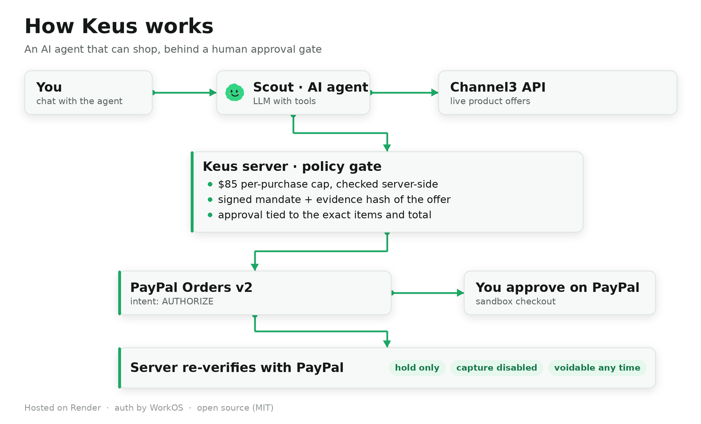

# Keus: human-approved shopping with PayPal sandbox checkout

Keus combines AI-assisted product discovery, purchase reviews and spending limits with **per-purchase PayPal sandbox approval**. A saved wallet or PayPal Vault grant is not required.



Architecture, purchase sequence, checkout state machine and trust model, as Mermaid diagrams: [docs/ARCHITECTURE.md](docs/ARCHITECTURE.md).

## For PayPal AI Hackathon judges

- **Hosted demo:** https://keus-staging.onrender.com. Use the one-click **Launch Judge Workspace** on the sign-in page for a look around; enter the **judge access code** (Devpost testing instructions) for a private workspace with PayPal sandbox checkout enabled, or create an account (email code, Google or GitHub).
- **Step-by-step judging guide, local setup and code map:** [docs/JUDGING.md](docs/JUDGING.md).
- **How it is built:** [docs/ARCHITECTURE.md](docs/ARCHITECTURE.md) (system overview, sequence diagram, state machine, trust model, repository map).
- **New project, built entirely during the submission period:** see [Build log, October to November 2026](#build-log-october-to-november-2026).

## Current payment flow

1. Ask your shopping agent to find and review a product.
2. Request a purchase and review the amount and merchant reference shown in chat.
3. Click **Review checkout**. This records Keus consent only; it does not place a PayPal hold.
4. In **PayPal checkout**, click **Get PayPal approval link**, then open the displayed link and approve that specific purchase using a sandbox buyer account. If opening a new tab is blocked, use **Copy approval address** and paste it into a new browser tab.
5. The server verifies the PayPal order, amount, merchant, user/session binding and current spending limits before requesting an `AUTHORIZE` hold.
6. After server verification, the PayPal return page takes you back to the **originating agent**. A verified checkout update appears in that conversation and is provided to the agent as separate server context on the next turn. Cancellation and unconfirmed results are never labelled successful. The original tab also refreshes via a same-origin notification, without losing an unsent draft.
7. Use **PayPal checkout** to inspect or **Void sandbox hold**. Voiding updates the agent conversation too. Checkout status and verified messages survive page reloads.

**Sandbox only. Capture is disabled server-side. No real product seller order, shipment, card issuance or merchant fulfillment occurs.** The payment recipient is the app's sandbox business account, not the catalog merchant. Shipping information is not requested by checkout.

Demo identities (the 1-click workspaces) cannot execute checkout: use the access-code judge workspace or your own Keus account with a PayPal sandbox buyer. Missing credentials and provider failures never fall back to simulated success in this flow.

## Purchase quantities

Ask for a quantity in chat, for example **“Buy 3 of that notebook.”** Purchase reviews and checkout listings show the quantity, unit price and line subtotal. Bundles can contain up to ten product lines, each with a whole-number quantity from 1 to 20. Omitting quantity means one. Saved offer IDs use their stored unit prices; direct product details remain reviewed inputs, not independent price verification.

The server calculates totals in integer cents and applies spending limits to the full subtotal. The PayPal order carries matching item quantities, unit amounts and item-total breakdown; authorization verifies these values. Price, quantity and line totals are persisted and bound to the purchase review. Changing quantity requires a fresh review and approval, not editing an already-reviewed hold. Receipt messages and the agent's verified checkout context include the quantities. Shipping and tax are not invented or included.

Older mandates without quantity metadata still use their existing amount verification; the UI does not invent a breakdown for them. The itemized PayPal payload is covered by provider-mock tests and was exercised against the real sandbox on the deployed app (for example a 3 × $1.25 USD bundle authorized and voided).

## Development

Use Node 24 (see `.node-version`).

```sh
npm ci
cp .env.example .env.local
# Configure the private .env.local values before starting.
npm run dev
```

Open `/workspace` on the configured server (default port 3100). Configure the existing database, authentication and AI-provider services for a functional authenticated shopping demo. The desktop uses WorkOS authentication and libSQL/Turso storage; product discovery configuration remains separate from payment configuration. The server applies numbered database migrations on startup; back up an existing database before deploying migrations, including `0016_purchase_quantities.sql` (adds quantity metadata while preserving older mandates).

For payments configure only server-side sandbox credentials:

- `PAYPAL_ENV=sandbox`
- `PAYPAL_CLIENT_ID`: the sandbox business app Client ID
- `PAYPAL_CLIENT_SECRET`: that app's secret

Use a public HTTPS origin for the PayPal return flow (localhost HTTP is accepted for local fixtures). Never commit credentials, use live credentials, or paste secrets into chat. Vault IDs, buyer emails, passkeys and saved-wallet setup are not prerequisites for standard checkout.

## Verification and limitations

```sh
npm test
```

Local verification: **539 passing tests** (`npm test`), including the standard-checkout suite covering provider verification, ownership/session binding, expiry, spending-limit changes, duplicate requests, uncertain-result reconciliation, voiding, sandbox gates and HTTP CSRF checks. Desktop browser checks at 1440px and 390px exercise chat review, the separate approval tab, authorization, reload recovery, cancellation and voiding with a **mock provider**, real application HTTP and SQLite.

Actual PayPal sandbox testing on 2026-11-02 confirmed order creation, buyer approval, a $10.00 USD authorization (HTTP 201), authorization lookup and successful void (HTTP 200). Since then the **deployed** application (Render, WorkOS authentication, Turso database) has been exercised end to end on 2026-11-10: sign-in, onboarding, agent purchase review, PayPal approval in a separate tab, the automatic return callback, server verification, authorization holds and voids, including concurrent reviews, expired approvals (surfaced as `purchase_approval_expired`), cross-account isolation (other users receive 404 on your mandate IDs) and a database backup/restore plus rollback/roll-forward deploy drill. Every sandbox authorization created during testing was voided. No capture or Vault calls occurred.

If authorization is uncertain, use **Recheck PayPal status**, not a replacement purchase. Reconciliation reads provider state without requesting another authorization. Unresolved states remain reserved against the spending budget. A process interruption during order creation, a provider-expired hold, or an unconfirmed authorization with no retrievable provider result may need operator investigation; the application does not invent success or silently release that reservation.

## Payment interfaces

- `GET /api/commerce/paypal/checkout`: user/workspace-scoped checkout history.
- `POST /api/commerce/paypal/checkout/begin`: creates an unapproved AUTHORIZE order from a reviewed mandate, never client-supplied amounts.
- `GET /api/commerce/paypal/checkout/return`: no-store return page; strips callback query parameters and submits verification with the signed-in session.
- `POST .../complete`, `.../cancel`: session-bound callback completion/cancellation.
- `POST .../reconcile`, `.../void`: provider verification or explicit void of this user's hold.
- `POST .../return-context`, `.../result`: session-bound callback destination and user/workspace-owned result, with agent identity resolved from the stored purchase rather than client-supplied redirects.

Legacy `/paypal/authorize`, `/paypal/capture`, `/paypal/refund`, `/paypal/void`, and mandate passkey payment-execution routes reject requests. Code from the first in-hackathon iteration (saved-wallet and earlier rails, October 2026) is retained outside the active payment path. Its presence is not a claim of real merchant-order support.

[Earlier in-hackathon design, explicitly not current behavior](docs/legacy-checkout-design.md). License: MIT.

## Build log, October to November 2026

Keus is a new project. Nothing in this repository predates the PayPal AI Hackathon submission period (1 October to 12 November 2026); the first commit to this repository was made on 26 October 2026, and the earliest iteration was written during October. Highlights, in the order they landed:

- **Per-purchase PayPal sandbox checkout** superseded the first in-hackathon iteration (a saved-wallet/Vault design from early October): `AUTHORIZE`-intent Orders v2 flow, server-side verification of amount, currency, merchant reference, quantity breakdown, session binding and live spending limits; reconcile and void; capture disabled; legacy execution routes now reject requests (`docs/legacy-checkout-design.md` preserves that first iteration's design notes).
- **Agent purchase reviews with quantities and bundles** (up to ten lines, integer-cent totals), itemized PayPal payloads, checkout batching and fail-closed currency handling.
- **Grounded product comparison** and search fixes on top of Channel3 discovery.
- **Authentication**: WorkOS email + password with verification codes, Google/GitHub sign-in, password reset, sign-up provisioning with a starter agent, one-click judge fast lane.
- **Provider-agnostic AI layer** with admin-managed, encrypted provider keys (OpenAI-compatible and Anthropic protocols).
- **Three-step onboarding**, workspace URL consolidation (`/workspace`), retirement of the separate account and mobile companion pages, accessibility and contrast fixes.
- **Operations**: Render deployment with health surfaces, numbered migrations (`0001`–`0016`) with drift checks, encrypted Turso backup/restore, rollback drill, secret scans and key rotation, and a test suite that grew to 539 passing tests.
