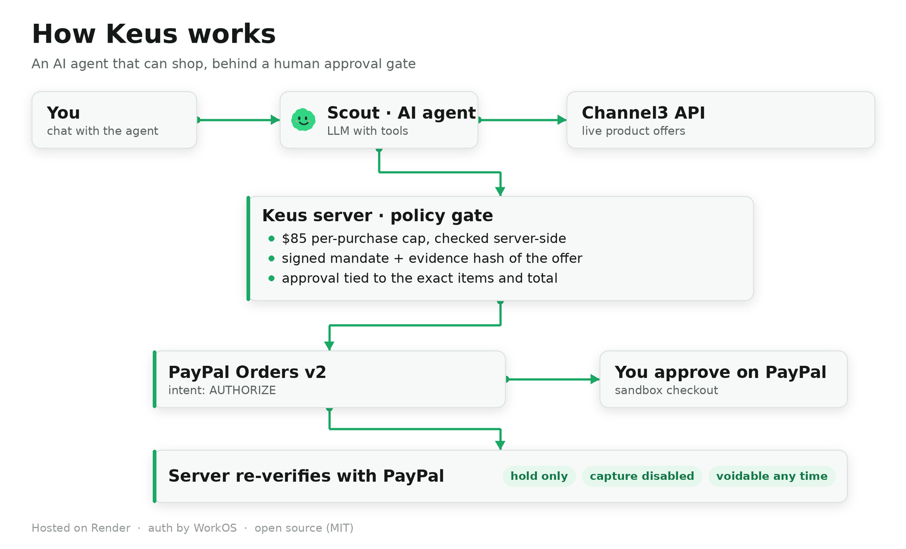
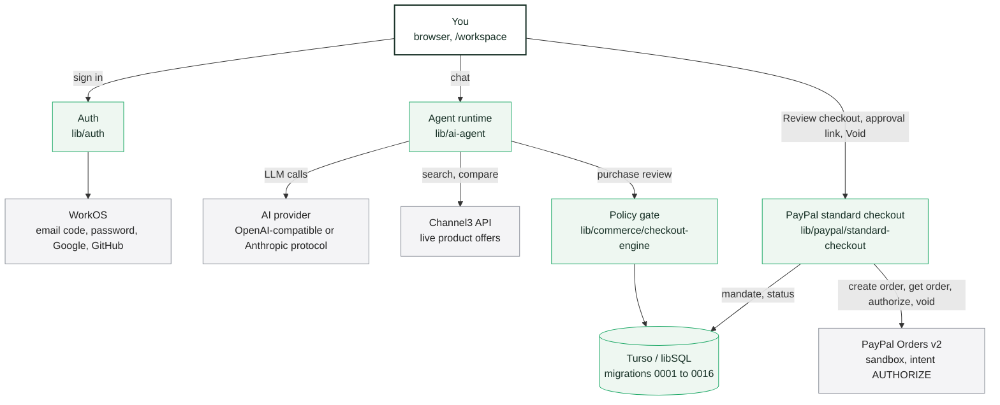
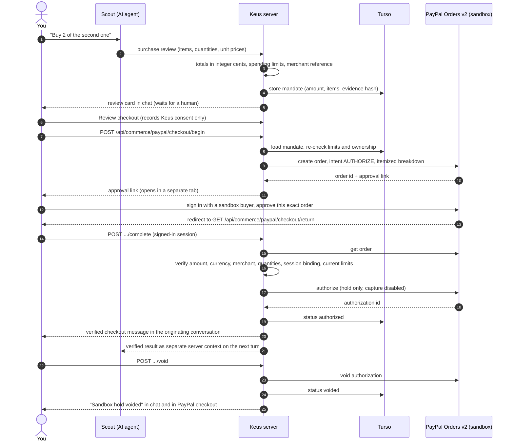
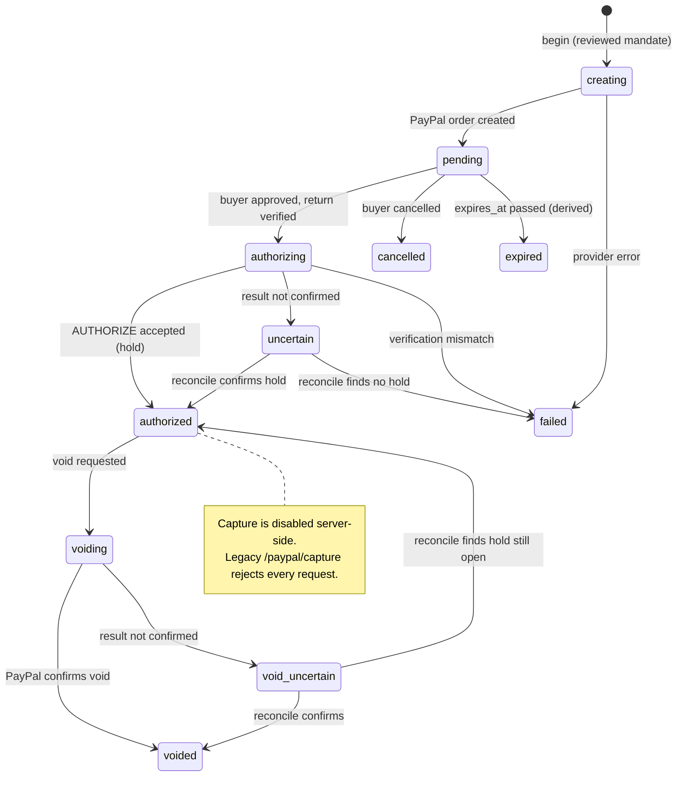
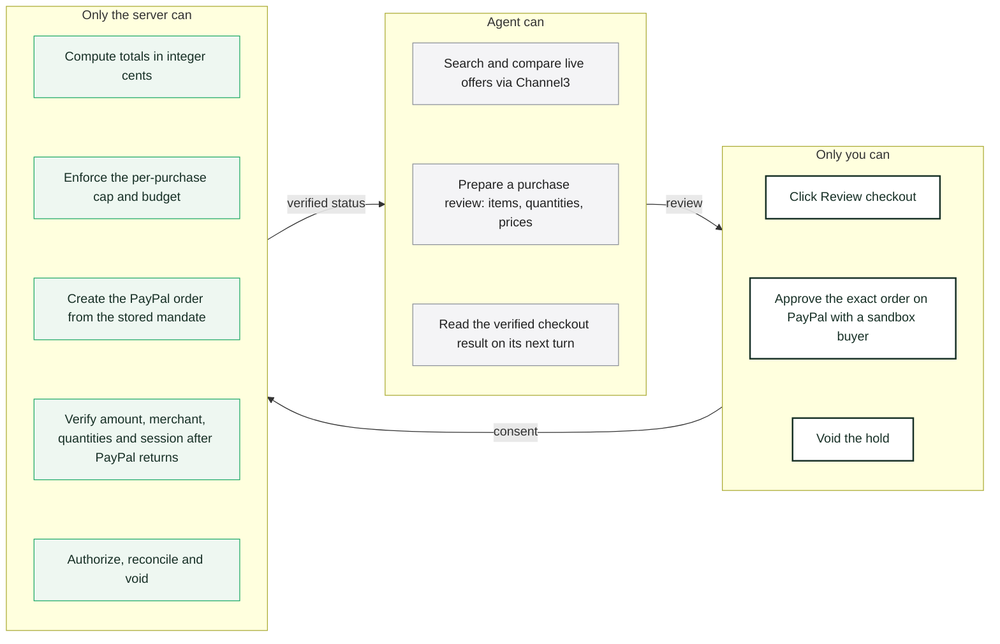

# Keus architecture

How an AI shopping agent, a human approval gate and PayPal sandbox checkout fit together. Diagrams are Mermaid and render directly on GitHub. Everything described here runs against the PayPal **sandbox** only; capture is disabled server-side.

Contents

1. [System overview](#1-system-overview)
2. [Purchase flow, step by step](#2-purchase-flow-step-by-step)
3. [Checkout state machine](#3-checkout-state-machine)
4. [Trust model: what the agent can and cannot do](#4-trust-model-what-the-agent-can-and-cannot-do)
5. [Repository map](#5-repository-map)



## 1. System overview

The browser talks only to the Keus server. Every external service (PayPal, Channel3, the AI provider, WorkOS, Turso) is called from the server with server-held credentials. The agent never sees a payment credential and never calls PayPal.



Green nodes run inside the Keus server (`apps/web`, Node 24, hosted on Render). Grey nodes are external services, called only from the server with server-held credentials. The buyer approves the order on PayPal in a separate tab and is sent back to `GET /api/commerce/paypal/checkout/return`, which hands the result to the signed-in session for verification.

Hosting: `render.yaml` with health endpoints; the database is Turso (libSQL) with numbered migrations applied on startup.

## 2. Purchase flow, step by step

The agent prepares; the human approves; the server verifies twice (before creating the order and again after PayPal returns). Amounts always come from the stored, reviewed mandate, never from the client.



Uncertain results (network interruption, provider timeout) are never shown as success. `POST .../reconcile` reads provider state and resolves `uncertain` without requesting a second authorization.

## 3. Checkout state machine

States are the `status` column of `paypal_standard_checkouts` (migration `0015`); `expired` is derived when a `pending` checkout passes `expires_at` (the API answers `410 purchase_approval_expired`). `voided`, `cancelled`, `failed` and `expired` are terminal. There is no path to capture.



Budget accounting: `authorizing`, `authorized`, `voiding`, `uncertain` and `void_uncertain` all count against the agent's spending limit, so an unresolved hold can never be used to exceed the cap.

## 4. Trust model: what the agent can and cannot do



Guarantees enforced in code and covered by tests (`npm test`, 539 passing):

| Guarantee | Where |
|---|---|
| Amount, currency and merchant reference come from the stored mandate, never from the request body | `lib/paypal/standard-checkout.mjs` |
| Spending limits re-checked at `begin` and again at `complete` | `lib/commerce/checkout-engine.mjs` |
| Checkout bound to the signed-in user, workspace and session; other users get 404 on your mandate ids | `lib/paypal/standard-checkout.mjs`, `lib/auth` |
| Mandate challenge hash binds workspace, run, amount, currency, merchant and the `sha256:` evidence hash of the reviewed offer | `lib/channel3/mandate-service.mjs`, `packages/shared/src/mandate.mjs` |
| Capture disabled; legacy authorize/capture/refund routes reject | `lib/paypal/endpoints.mjs` |
| Fail closed: missing credentials or provider errors never become simulated success | checkout suite in `tests/unit` |
| Shared judge identity cannot check out (`403 checkout_personal_account_required`) | `lib/auth`, `lib/paypal/standard-checkout.mjs` |

## 5. Repository map

```text
Kues/                         npm workspaces monorepo, Node 24, MIT
  apps/web/                   the application
    server.mjs                HTTP server, routes, static UI
    lib/auth/                 WorkOS (email code, password, Google, GitHub), judge fast lane, sessions
    lib/ai-agent/             agent runtime, tools, purchase reviews, baskets
    lib/ai-providers/         OpenAI-compatible and Anthropic protocols, encrypted admin-managed keys
    lib/channel3/             product discovery, mandate service (challenge and evidence hash)
    lib/commerce/             checkout-engine (limits, integer-cent totals), purchase-items
    lib/paypal/               standard-checkout (begin, complete, reconcile, void), endpoints, idempotency
    lib/db/ + migrations/     Turso / libSQL client, numbered migrations 0001 to 0016
    public/                   workspace UI, login page, PayPal return page
  apps/bridge/                Android device bridge doctor (legacy, not in the checkout path)
  packages/shared/            mandate.mjs, goals.mjs, agent-identity.mjs, flight-box.mjs
  tests/unit/                 539 tests: mock PayPal provider, real HTTP, SQLite
  docs/                       JUDGING.md, ARCHITECTURE.md, legacy-checkout-design.md
  render.yaml                 Render deployment
```

Related reading: [JUDGING.md](JUDGING.md) for the step-by-step judge walkthrough and local setup, [legacy-checkout-design.md](legacy-checkout-design.md) for the first in-hackathon iteration (a saved-wallet design from October 2026, not current behaviour).
